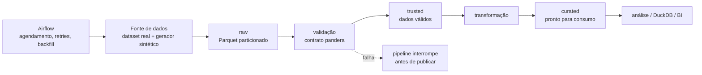

# credito-data-pipeline

Pipeline de dados para análise de inadimplência de clientes de cartão de crédito. Evolução em engenharia de dados do projeto [Analise-de-clientes-inadimplentes](https://github.com/fsemeneze/Analise-de-clientes-inadimplentes), que fazia toda a exploração em um único notebook sobre 10 mil registros.

Este projeto resolve o outro lado do problema: **um pipeline de ponta a ponta que ingere, valida, transforma e publica os dados de crédito em escala (~10 milhões de observações)**, com as práticas de engenharia que a análise precisa para funcionar em produção: código modular, contrato de validação de dados, testes automatizados, CI e — nas fases seguintes — orquestração com Airflow e camadas de dados em Parquet/S3.

## Arquitetura



As fases de implementação estão detalhadas em [Roadmap](#roadmap).

## Requisitos

- Python 3.11+
- Git

## Setup (Windows / macOS / Linux)

```bash
# Windows PowerShell
python -m venv .venv
.venv\Scripts\pip install -U pip
.venv\Scripts\pip install -e ".[dev]"
```

No Linux/macOS:

```bash
python -m venv .venv
source .venv/bin/activate
pip install -e ".[dev]"
```

### Rodar o pipeline

```bash
credito --version
credito run --limit 1000   # fase 0: comando ainda não implementado (fase 1)
```

### Lint e testes

```bash
ruff check .
ruff format --check .
pytest
```

## Estrutura do projeto

```
src/credito_pipeline/
├── config.py          # camadas de dados, caminhos e configuração
├── log.py             # logging padrão
├── generation.py      # gerador de dados sintéticos calibrado no dataset real
├── ingestion.py       # camada raw
├── validation.py      # contrato de dados (pandera)
├── transformation.py  # camada curated
├── load.py            # gravação, particionamento e switch local/s3
└── cli.py             # ponto de entrada
data/
└── creditos_clientes.csv   # dataset real de calibração (contrato de referência)
tests/
.github/workflows/ci.yml  # lint + testes a cada push
```

## Roadmap

- [x] **Fase 0 — Fundação:** estrutura modular, `pyproject`, CI (ruff + pytest), logging, CLI
- [ ] **Fase 1 — Pipeline + gerador:** dados sintéticos em escala calibrados no dataset real, validação com pandera, testes unitários
  - [x] Módulo de calibração (dataset real como contrato de referência)
  - [x] Gerador sintético: bootstrap com reposição + snapshots mensais + inadimplência como cadeia de Markov calibrada na taxa real
  - [ ] Validação com pandera (contrato de dados)
  - [ ] Transformação e camadas trusted/curated
- [ ] **Fase 2 — Orquestração e storage:** Airflow (DAG incremental por mês, backfill, retries), Parquet particionado, S3/MinIO
- [ ] **Fase 3 — Fechamento:** análise consumindo a camada curated, benchmark de performance, README final

## Stack

Python · pandas · pandera · PyArrow/Parquet · DuckDB (planejada) · Airflow (planejada) · Docker (planejada) · MinIO/S3 (planejada)
